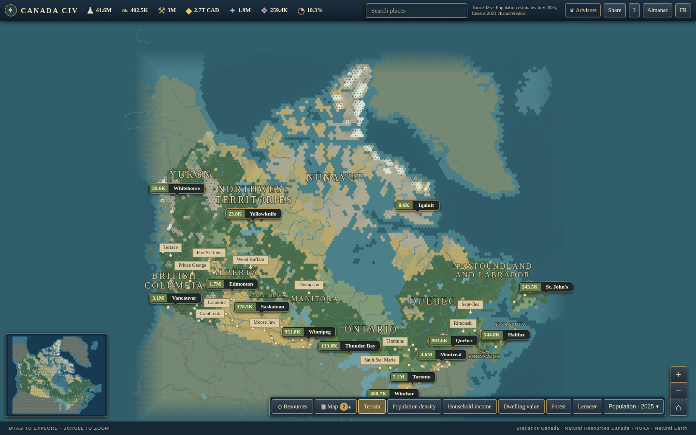
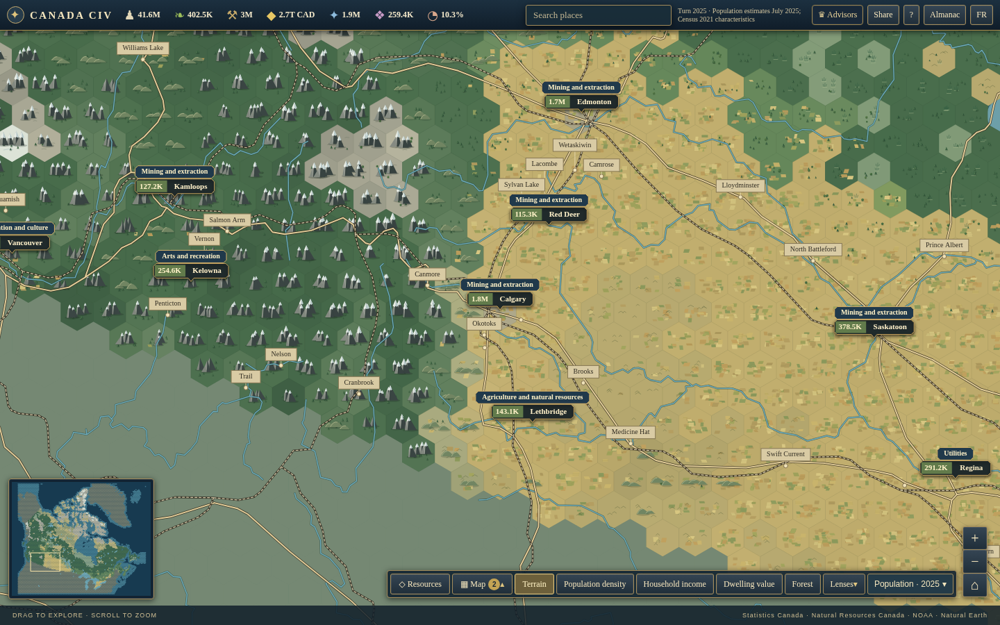
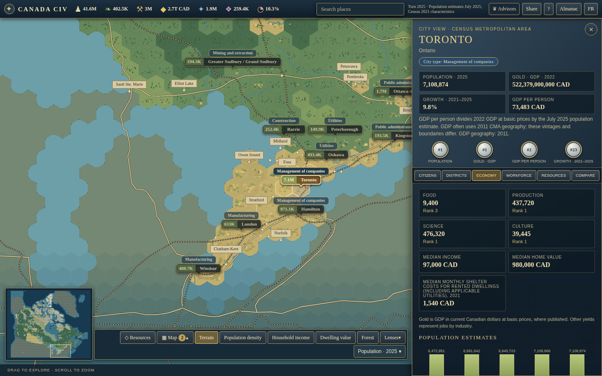

# Canada Civ

Canada Civ is a **read-only, Civilization-styled data atlas of Canada**: the real landmass drawn as a hex map, with yields, city and province panels, data lenses, and an Almanac that traces every number back to an official open source. It is a visualizer, not a game. There are no units, tech trees, opponents, or win conditions.

It covers **all 10 provinces and 3 territories**, including the North, in a **bilingual English and French** interface.

## Inspiration and attribution

This project is inspired by [usaciv](https://karpathy.ai/usaciv/) by [Andrej Karpathy](https://x.com/karpathy/status/2125779541952246039): *the United States as a strategy-game map*, built from public data. Karpathy released the original under the MIT License as [usaciv-source.zip](https://karpathy.ai/usaciv/usaciv-source.zip). Canada Civ follows that idea, architecture, and honesty rules for Canadian geography and statistics. We do not claim affiliation with Karpathy or with any game publisher. See [NOTICE](NOTICE) and [docs/REFERENCE-USACIV.md](docs/REFERENCE-USACIV.md).

## Status

**v1.0** (tag `v1.0`). A bilingual, read-only hex atlas of all 13 provinces and territories, with official Statistics Canada and Natural Resources Canada figures, City and Town views, data lenses, Advisors, Explorer, a population time slider, and shareable links and PNG images. Inspired by usaciv; not affiliated with Karpathy or any game publisher. The Indigenous lands overlay remains out of scope. Official figures were independently checked; see [docs/verification-notes.md](docs/verification-notes.md). Remaining visual gaps versus usaciv are listed in [CHANGELOG.md](CHANGELOG.md). [docs/SPEC.md](docs/SPEC.md) is the source of truth.

## Live site

The atlas is at [https://shawnpang.xyz/canada-civ](https://shawnpang.xyz/canada-civ). The same static build is also served at [https://canada-civ.vercel.app](https://canada-civ.vercel.app). Relative asset and data URLs work at both origins; under the `/canada-civ` path, a small script sets `<base href="/canada-civ/">` so CSS, modules, and `data/*.json` resolve correctly, including when the URL has no trailing slash. Share links use the address bar, so they keep whichever host you are on.


## Run locally

You need [Python](https://www.python.org/) 3.11+ and [uv](https://docs.astral.sh/uv/). No Node bundler or database is required. The site is static files in `web/`.

```bash
git clone https://github.com/shawnpang/canada-civ.git
cd canada-civ
uv run python -m pipeline serve
```

Then open [http://127.0.0.1:8765/](http://127.0.0.1:8765/) in a browser. Optional flags: `--port 8000`.

Useful checks:

```bash
uv run python -m pipeline check
uv run python -m unittest discover -s tests
```

Rebuilding published JSON from official extracts is optional and needs the cached source files under `data/raw/` (that directory is gitignored). `uv run python -m pipeline fetch` downloads what the pipeline knows how to fetch; `uv run python -m pipeline build` and `all` rebuild the web catalogues and automatically re-merge the Canadian Disaster Database lens when the official extract is present.

## Screenshots

The national landing view, with painted terrain, default roads and rail, and official province names:



Zoomed terrain in the Rockies and Prairies, with official land cover, relief, rivers, and Atlas of Canada roads and rail:



City View for Toronto, with official population, GDP, and ranks computed from those figures:



## What “done” looks like

A static site, served from `web/` with no bundler, that:

1. Shows all 13 provinces and territories on one hex map (EPSG:3347, 25 km hex radius unless the spike records a measured reason to change it).
2. Lets a visitor search, pan, zoom, open a CMA or territorial capital, open a province or territory, switch lenses, and share a URL that restores the same view.
3. Displays national yields (Population, Food, Production, Gold, Science, Culture, Unemployment) named in Civ language but computed from real Statistics Canada figures, in Canadian dollars where money is shown.
4. Works in English and French, including chrome, Almanac, and official place names.
5. Cites every visible number in the Almanac, with vintage and licence.

The full definition of done, schemas, sources, UI, and acceptance criteria are in the docs below.

## Docs

| Doc | Purpose |
| --- | --- |
| [docs/SPEC.md](docs/SPEC.md) | Implementation-ready product and technical spec (read this first for “what to build”) |
| [docs/MILESTONES.md](docs/MILESTONES.md) | Ordered milestones and agent-sized tasks, MVP first |
| [docs/DATA-SOURCES.md](docs/DATA-SOURCES.md) | Canadian data sources, licences, URLs, and what each feeds |
| [docs/REFERENCE-USACIV.md](docs/REFERENCE-USACIV.md) | How the original usaciv works, with screenshots |
| [AGENTS.md](AGENTS.md) | Instructions for coding agents: read order, conventions, how to verify |
| [NOTICE](NOTICE) | Attribution to usaciv and data-licence reminder |

## Licence

Code and documentation in this repository are [MIT](LICENSE). Upstream usaciv code, if later reused, remains Karpathy’s MIT work (see [NOTICE](NOTICE)). Government data is under its own open licences and requires attribution.
