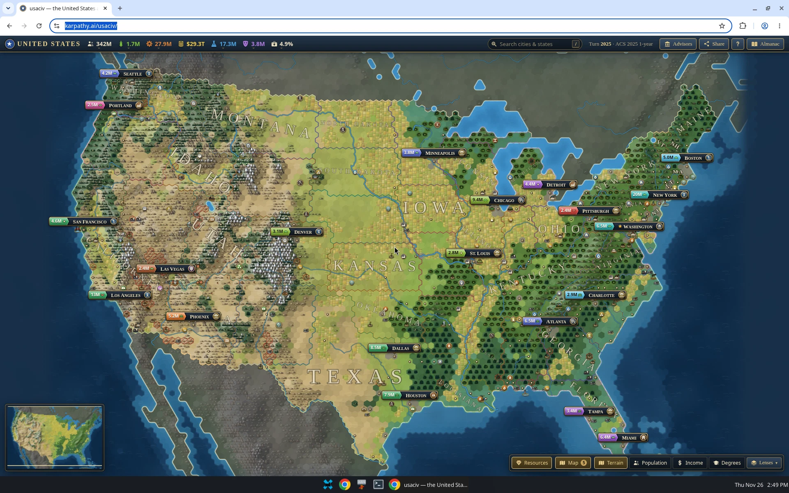
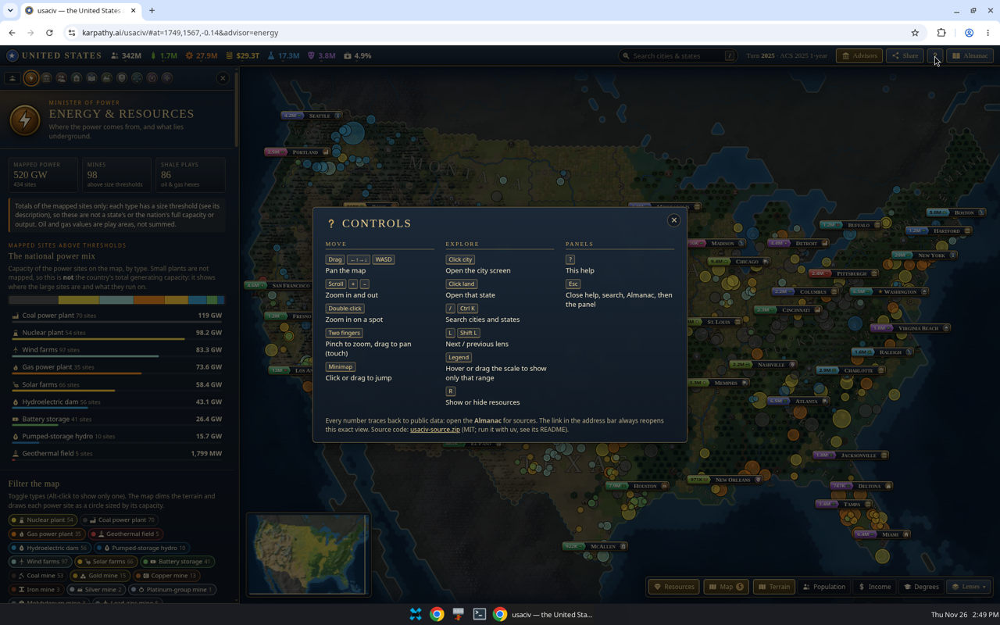
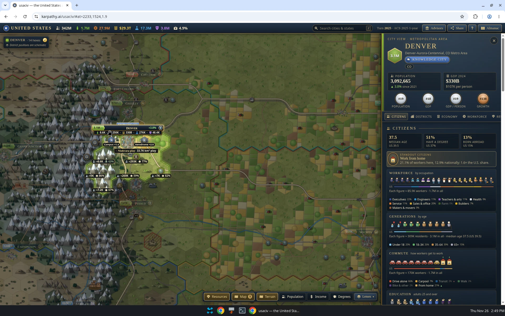
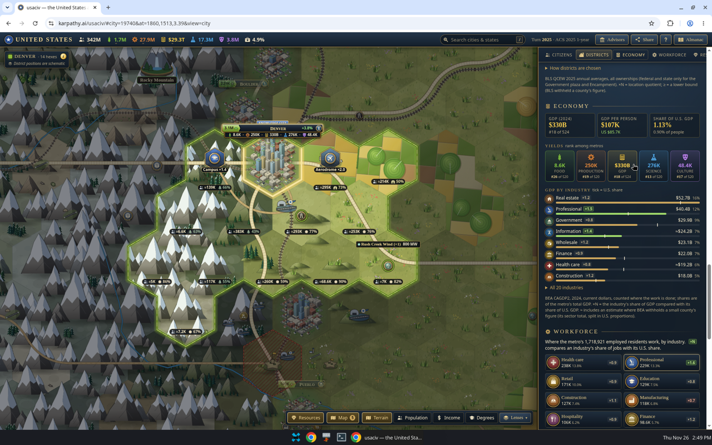
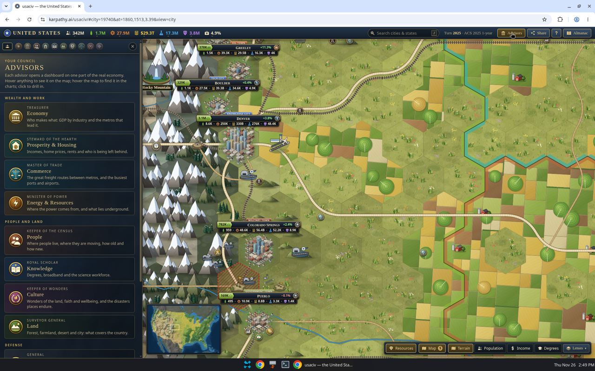
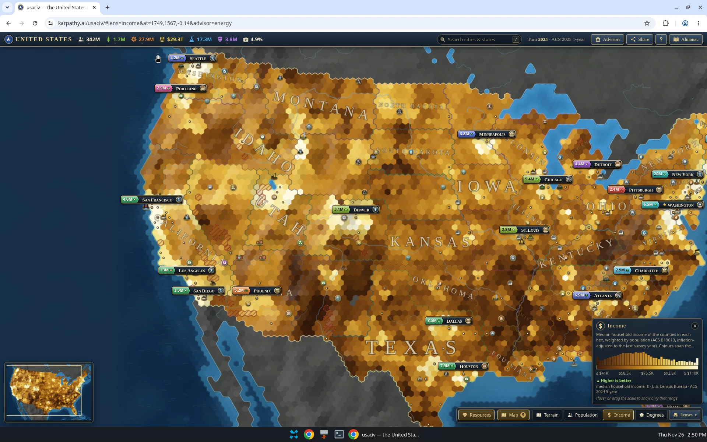
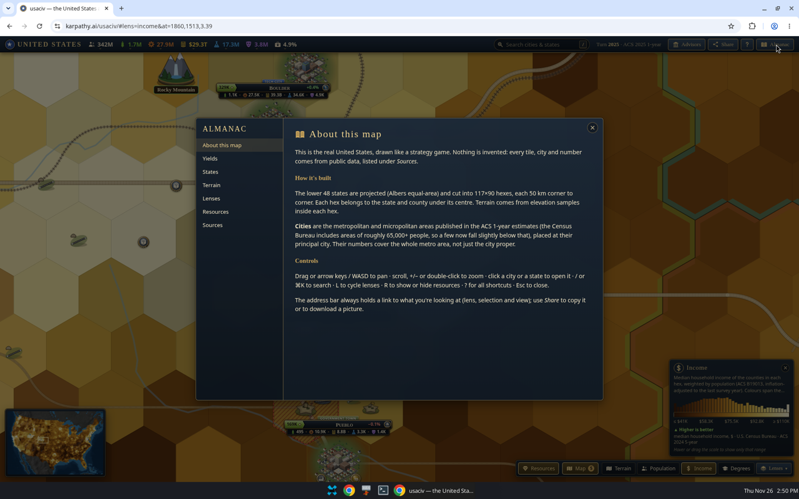
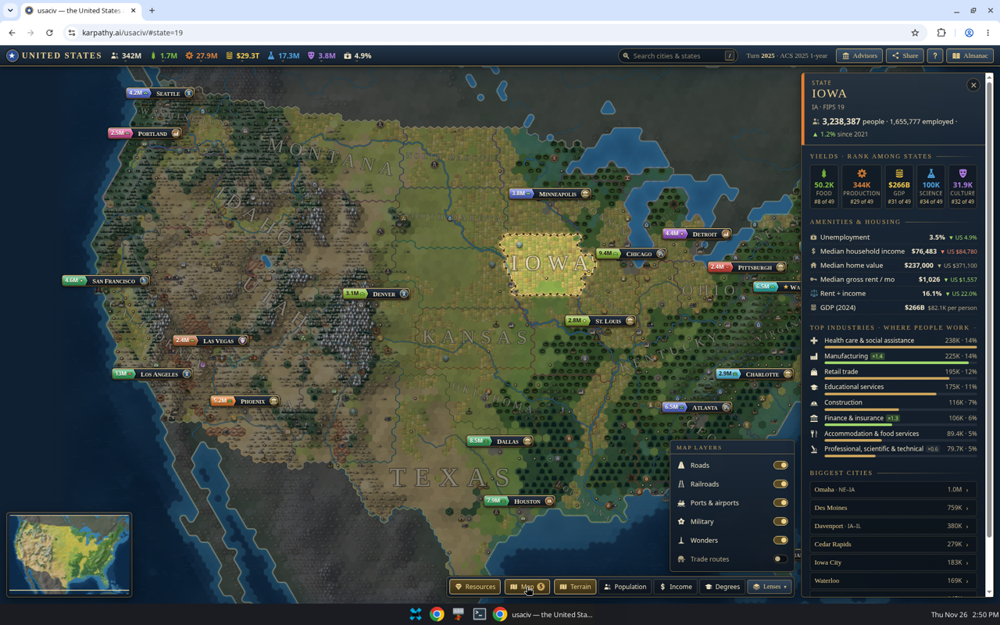

# Reference: how usaciv works

Canada Civ is a counterpart to **usaciv**, not a reskin of the United States. Read this so you can match the interaction model, honesty rules, and architecture — then implement Canadian geography and Canadian sources as specified in [SPEC.md](SPEC.md).

- Live site: https://karpathy.ai/usaciv/
- Announcement (26 November 2026, 10:31 AM SGT): https://x.com/karpathy/status/2125779541952246039
- Official source (MIT, Copyright 2026 Andrej Karpathy): https://karpathy.ai/usaciv/usaciv-source.zip
- Help (`?`) in the app also links that zip.

**Do not copy the usaciv source tree into this repository.** You may download the zip locally for reference.

Karpathy’s README calls usaciv “a visualizer (not a game).” He built it in about seven hours with Claude Code (Opus 5.5, medium effort, ultracode on), from 31 public US sources, and invited others to take the idea further.

## What you see

The product is a Civ-VI-styled atlas of the **contiguous United States** (lower 48 + Washington, DC). Alaska, Hawaii, and territories are omitted. You pan, zoom, search, open cities and states, switch choropleth lenses, toggle map layers, open advisor dashboards, and share a URL or a 1600×900 PNG. You do not move units or end a turn. The top-bar “Turn 2025 · ACS 2025 1-year” is the data vintage, not a game clock.



*Landing view. Painted hex terrain, bronze city banners, national yield chips across the top.*



*Help (`?`). Controls, plus the official source-zip link. Canada Civ’s help must also cite sources and the MIT / data licences.*

## Architecture (reference)

Two parts:

1. A **Python 3.11+ pipeline**, standard library only, run with `uv`. Flow: `fetch` → `process` (publisher files → `data/interim/`) → `build` (reconcile onto a hex grid → `web/data/*.json`) → `check` (contracts + quality). First fetch is about 500 MB, cached. Built JSON is about 6 MB and ships with the zip, so `uv run python -m pipeline serve` works immediately.
2. A **static frontend**: plain ES modules, Canvas 2D, no framework, no npm, no bundler. Extensions (City View, Advisors, map layers) hook a small `app` API.

Hex grid: pointy-top, odd-r, **radius 25 km** (vertex-to-vertex 50 km, area about 1,600 km²). Projection: Albers equal-area conic with USGS lower-48 parameters, origin top-left, Y down, units in km. Built grid: **117×90 = 10,530** cells (4,807 US land, 3,590 water, 2,133 foreign). Canada Civ must recompute its own grid on EPSG:3347; do not reuse 117×90.

Terrain: ETOPO1 elevation (relief thresholds: hills if elevation SD ≥ 85 m, mountains if SD ≥ 260 m or mean ≥ 2,300 m, peaks if mean ≥ 2,700 m; valley-floor exception). NLCD 2021 land cover, urban if developed ≥ 30%. Ownership from seven sample points per hex. Those rules, with a Canadian land-cover crosswalk, are the starting point for Canada Civ (see SPEC).

## The Civ metaphor (numbers stay real)

| Civ name | In usaciv |
| --- | --- |
| Gold | GDP (BEA CAGDP2), where the work is done |
| Food / Production / Science / Culture | ACS job counts by industry, where people live |
| Districts and city badges | BLS QCEW location quotients; plaques are schematic, not zoning maps |
| Citizens | Workforce mix as pictogram rows |
| Wonders | 52 sites by *published* rules (park visits, university R&D) plus 12 curated landmarks |
| Lenses | 19 county choropleths, brushable histogram, each with a caveat |
| Advisors | Nine dashboards + Explorer, court titles, linked to the map |
| Forts / trade / resources | Real installations, FAF5 freight, EIA/MSHA sites with published cutoffs |

Missing values are `null`, never `0`. Every number is in the Almanac.



*City View opens from a banner. The metro is a real statistical area.*



*District plaques show what a metro specialises in, not where those jobs sit inside the metro. Copy this honesty rule.*



*Nine advisors plus Explorer. Flavour titles; real statistics.*



*Lenses colour every county. The legend is a histogram you can brush.*



*The Almanac is the bibliography and the caveat list, not lore.*



*Optional layers on the hexes, toggled from the Map menu.*

## URL hash (reference)

usaciv stores view state in the hash, for example:

```
#lens=income&city=35620&state=06&at=x,y,zoom
```

`at` is the map-km centre and a zoom parameter that frames the same area on any screen. Lens or selection changes push history (Back undoes them); camera moves replace the current entry. A `layers` key records non-default map toggles. Canada Civ must use the same idea, with `province` and `lang` as specified in SPEC.

## Controls (reference)

- Pan: drag, WASD, arrow keys. Zoom: scroll, `+` / `–`, pinch, double-click.
- Search: `/` or Ctrl/⌘K.
- `L` / Shift+`L` cycle lenses. `R` toggles resources.
- `?` help, Esc closes the topmost panel.
- Click city → City View. Click land → state panel. Minimap click/drag jumps.
- Works on phones (docks become bottom sheets).

## What usaciv deliberately is not

Not a playable 4X. Not a legal map (hexes are ~1,600 km²). Not affiliated with a game publisher (original procedural art). Not a complete United States (no AK/HI/territories). When praising a France fork, Karpathy noticed that it *did* include territories — Canada Civ treats full territorial coverage as required.

## Licence reminder

usaciv code is MIT. Most of its *data* is US public domain, with a notable exception (2020 US Religion Census). Canada Civ’s data is mostly **Open Government Licence – Canada** / **Statistics Canada Open Licence**, which require attribution. Do not assume public domain.
